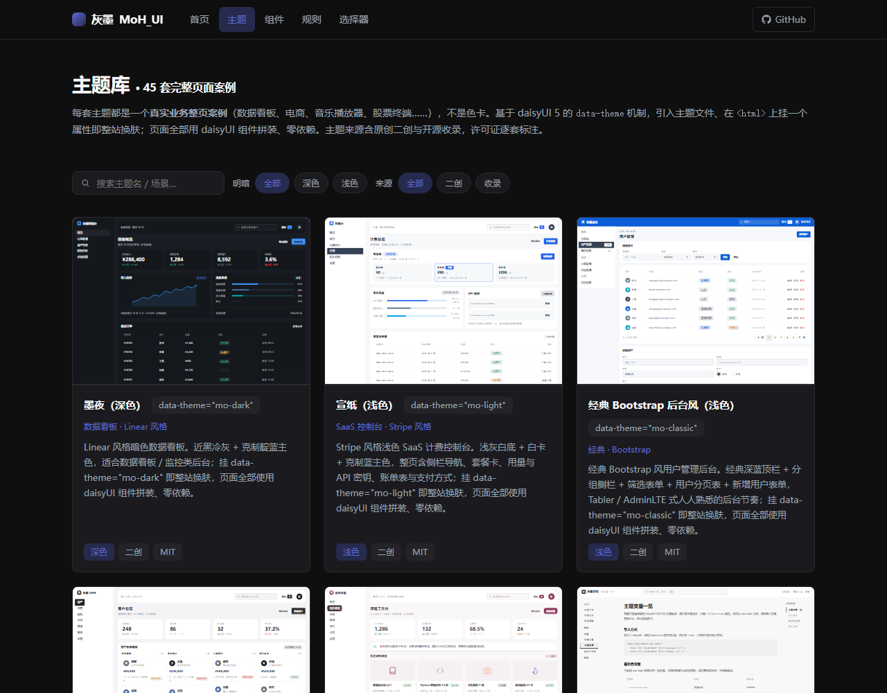
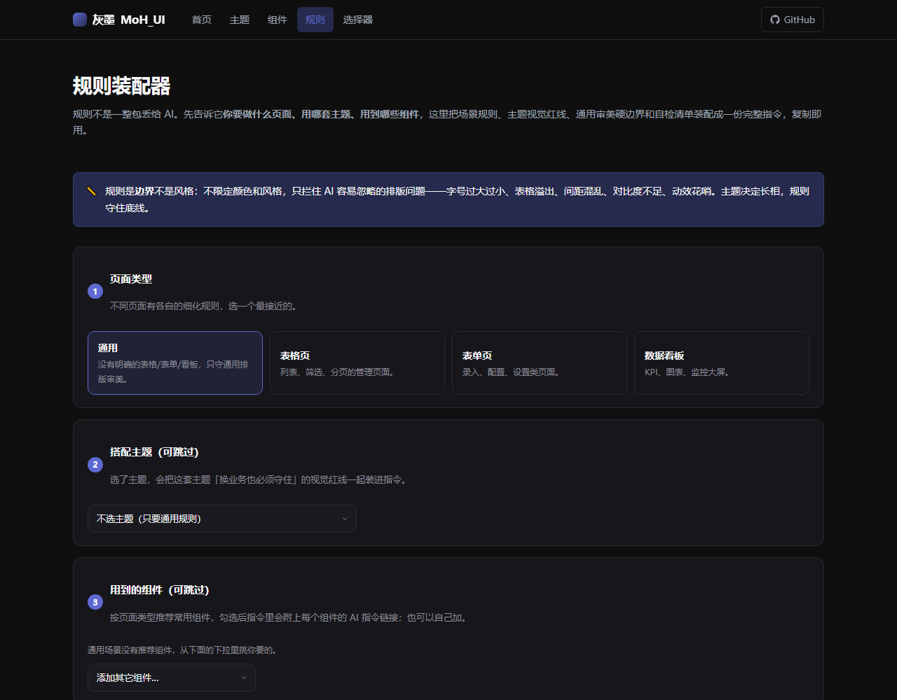
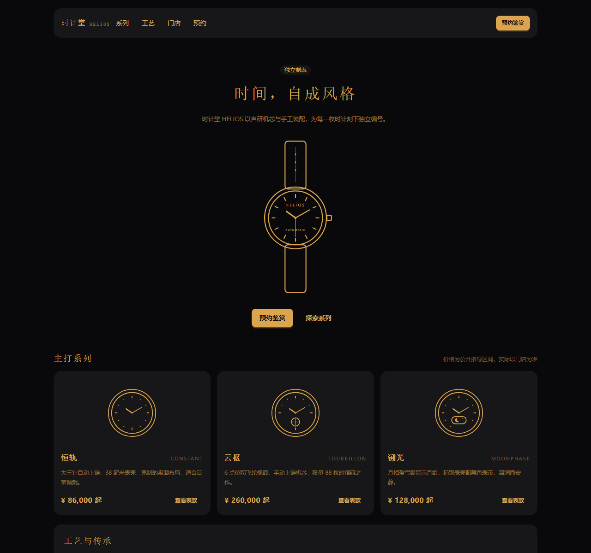
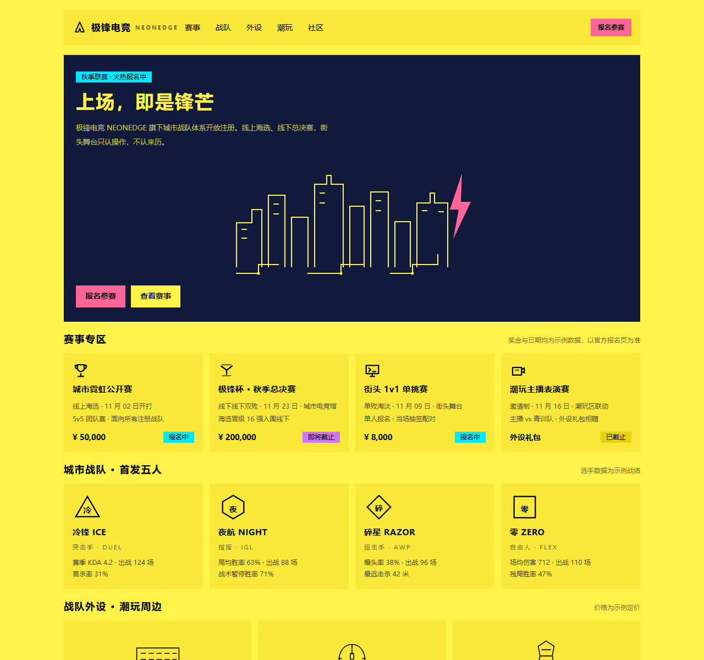
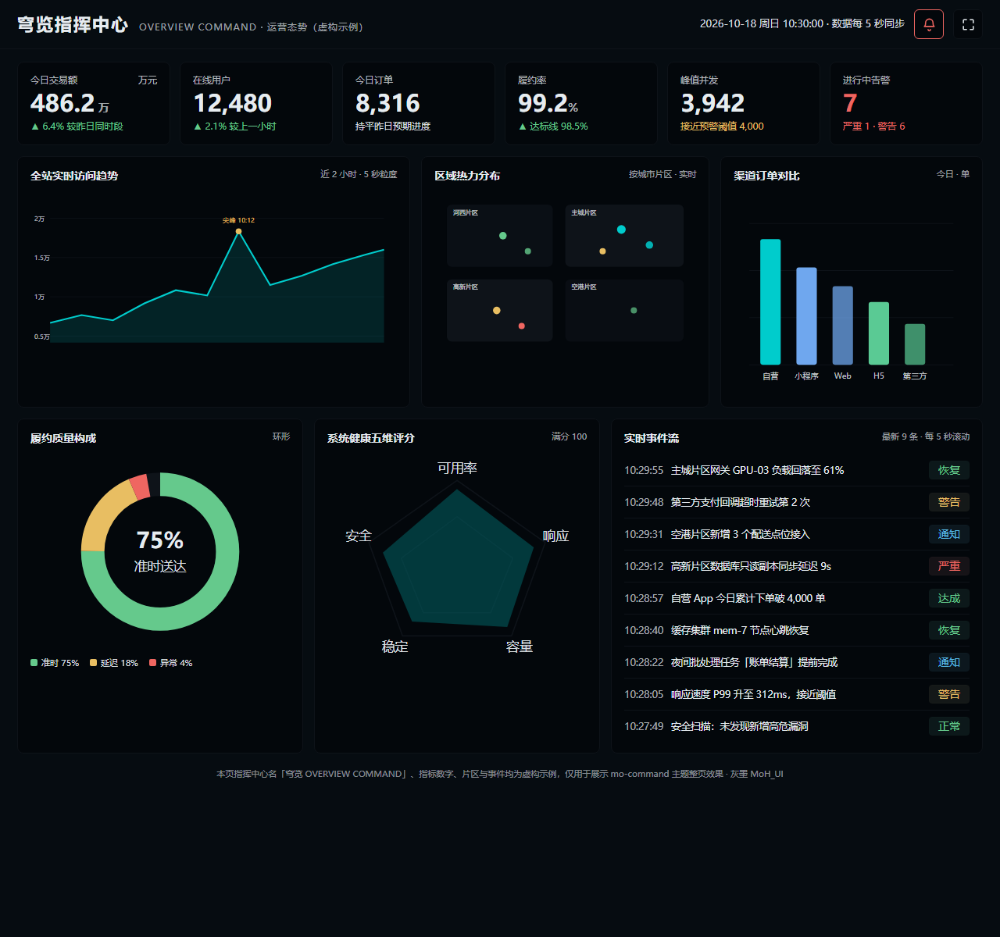
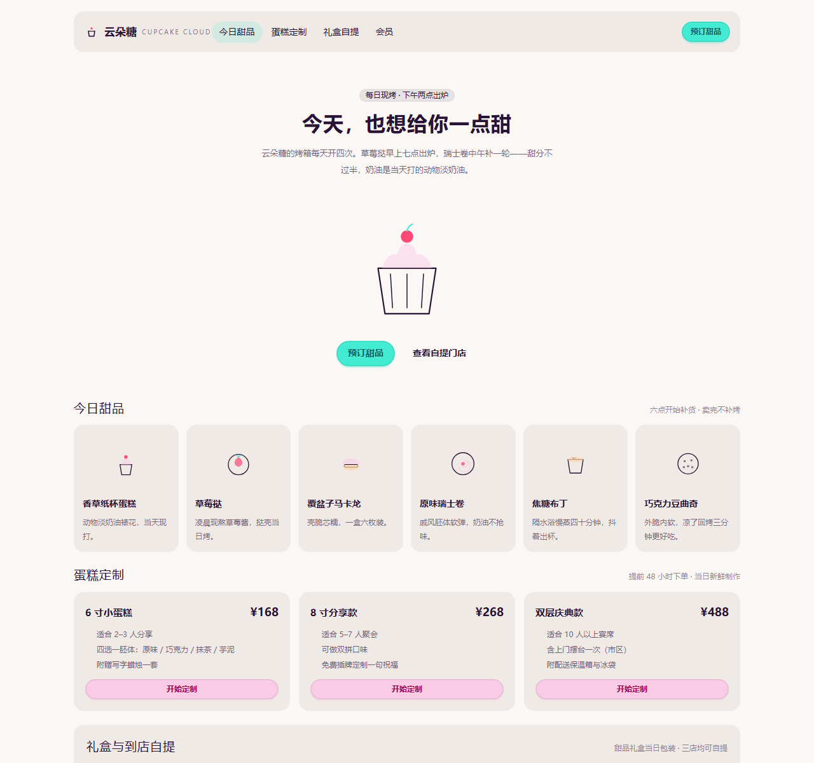
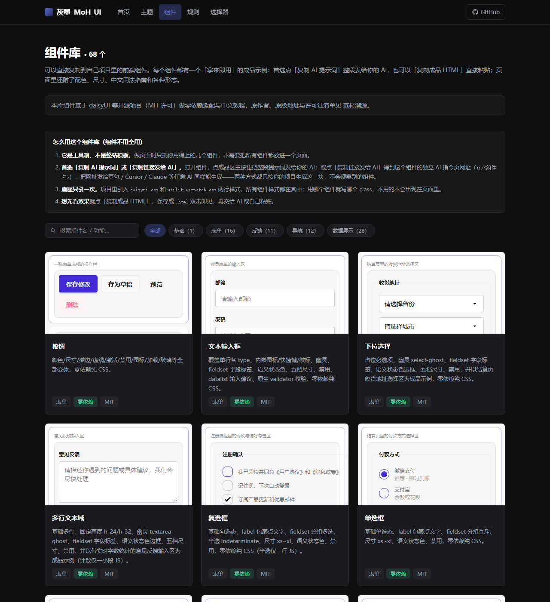

# 灰墨 · MoH_UI

> 给 AI 搭出来的项目做「审美急救」：45 套完整业务页面主题、68 个现成组件、113 份 AI 指令，加一套管排版的审美规则。

AI 写出来的页面功能都在，就是不好看：标题字号忽大忽小，表格在手机上撑出屏幕，间距靠感觉。灰墨解决的是这类问题。每个主题和组件都配好了 AI 指令，复制给豆包、Cursor 或其他 AI，它照着做；不用自己描述想要什么风格。

组件底座是 daisyUI 5，纯 CSS，不需要框架和构建工具。中文优先，所有素材的来源和许可证都逐个登记。

在线展示站：**https://noii-y.github.io/moh-ui/** · 仓库：https://github.com/noii-y/moh-ui



---

## 目录里有什么

### ① 规则装配器 —— 按你的页面现场拼一份排版规则

`rules/` 目录是规则原文，管的是 AI 容易忽略的排版问题：

- 主规则 `mo-rules-zh.md`：字号只在 12/13/14/16/20/24px 几档里取、间距按 8px 网格走、表格不许溢出、控件不小于 32px、颜色走变量、动效不超过 200ms
- 场景细则 `scenarios/`：表格页、表单页、数据看板三套专属规则（如数字列右对齐、表单 label 绑定、图表空态）
- 35 项自检清单 `selfcheck.md`：除通用排版外，新增弹层键盘（焦点进入 / 陷阱内循环 / Esc 与点外部关闭 / 焦点返回 / aria 属性）、触控移动（可点热区 44×44、390px 不溢出、减弱动效）两组，让 AI 改完逐项自查，不达标继续修

规则页（[site/rules.html](site/rules.html)）是一个装配器：选页面类型（通用 / 表格 / 表单 / 数据看板）→ 选主题（45 套，自动带上该主题的视觉红线）→ 勾选这页用到的组件 → 要不要自检清单，页面实时拼出一份专属规则，一键复制发给 AI。也可以直接用 URL 预选，例如：

```text
site/rules.html?scene=form&theme=luxury&comps=button,input
```

组件详情页的获取卡里还有「配套规则」入口，从组件一键反查到该场景的规则，不用自己判断该选哪类。



### ② 主题库 —— 45 套完整业务页面，不是色块

每套主题都是一个完整的业务页面 demo（腕表官网、电竞俱乐部、烘焙坊、堂食点单屏、指挥中心大屏、OA 审批中心……），能直接看到这套主题在真实页面里的样子。挂 `data-theme` 即可换肤。

45 套分三类：

| 类别 | 数量 | 来源 | 引入方式 |
| --- | --- | --- | --- |
| 官方内置 | 18 套 | daisyUI 官方（luxury、silk、caramellatte、cyberpunk、business、coffee 等） | 变量在 daisyui-themes.css 里，引两行 CSS 即可 |
| 外部收录 | 10 套 | catppuccin、dracula、nord、rose-pine、solarized、tokyo-night、kanagawa、gruvbox、github-light、everforest | 各自带 tokens.css，保留原许可证与署名 |
| 灰墨二创 | 17 套 | mo-dark、mo-light、mo-classic、mo-gray、mo-pastel、mo-slate、mo-mood、mo-brutal、mo-neon、mo-zhongshi、mo-gov、mo-press、mo-kids、mo-photo、mo-fleet、mo-command、mo-kiosk | 自带 tokens.css，标 original |

官方内置主题（以 luxury 为例）：

```html
<link rel="stylesheet" href="https://noii-y.github.io/moh-ui/vendor/daisyui.css">
<link rel="stylesheet" href="https://noii-y.github.io/moh-ui/vendor/daisyui-themes.css">
<html data-theme="luxury">
```

灰墨二创 / 外部收录主题（以 mo-dark 为例，多引一份该主题的 tokens.css）：

```html
<link rel="stylesheet" href="https://noii-y.github.io/moh-ui/vendor/daisyui.css">
<link rel="stylesheet" href="https://noii-y.github.io/moh-ui/themes/mo-dark/tokens.css">
<html data-theme="mo-dark">
```

每套主题都是 `demo.html`（整页案例）+ `README.md`（中文说明）+ `moh.json`（溯源元数据）三件套；二创和收录主题多一个 `tokens.css`。入口：[主题墙](site/themes.html)。

下面是四套风格反差很大的整页（黑金腕表、亮黄电竞、深色指挥大屏、暖白烘焙坊），全部是完整业务页面，不是几个色块：

 
 

### ③ 组件库 —— 68 个能搬进自己项目的组件

每个组件是「提示词三件套」：`demo.html`（真实业务成品 + 中文教程）+ `README.md` + `moh.json`。

- **63 个 daisyUI 搬运件**（`components/daisyui/`）：按钮、输入、表单、导航、数据展示、弹窗反馈、区块、特效，覆盖官方主要形态，类名就是 daisyUI 官方 class
- **5 个自研增强件**（`components/`）：`chart-card`（ECharts 图表，颜色读主题变量）、`code-block`（highlight.js 代码块）、`date-range`（日期范围筛选，零依赖）、`drag-sort`（拖拽排序）、`empty`（空状态）

首选用法是把组件页的「复制 AI 提示词」发给 AI，让它只生成这一块；也可以「复制成品 HTML」直接粘贴。想直接拷代码的，目标项目只需在 `<head>` 引两行底座：

```html
<link rel="stylesheet" href="https://noii-y.github.io/moh-ui/vendor/daisyui.css">
<link rel="stylesheet" href="https://noii-y.github.io/moh-ui/assets/utilities-patch.css">
```

入口：[组件集市](site/components.html)。



### ④ AI 指令分发 —— 113 份 AI 指令，含整页源码

每个组件和主题都有一个 AI 指令页：`ai/<名>.html`（人看版，一键复制）和 `ai/<名>.md`（纯文本，AI 直接抓取），共 113 份（68 个组件 + 45 套主题）。

- **组件指令**：真实场景 + 精确规格 + 单个成品的参考结构 + 审美规则，AI 不用二次猜测
- **主题指令**：除了换肤步骤和视觉红线，还内嵌了该主题完整 demo.html 的整页源码。即使你的 AI 不能联网，拿到纯文本也能把整页 1:1 还原出来，不会只换个主题色
- **`llms.txt`**：全库索引；**`llms-full.txt`**：全部指令拼接，适合让 AI 先了解整个库再批量生成

把任意指令页链接发给豆包、Cursor、Claude Code 等 AI 即可。指令页由 `scripts/build-ai-pages.mjs` 生成，手写文件里没有。

### 主题选择器 —— 62 套主题实时试

[site/generator.html](site/generator.html) 是一个 data-theme 沙箱：45 套完整页面案例之外，还内置了 17 套没做整页的官方主题，点卡片即可在沙箱里实时换肤、微调主色和圆角，合计 62 套可试。官方内置主题没有 tokens 文件，复制 tokens 按钮对它们禁用。

---

## 怎么配合用

| 你的情况 | 用什么 |
| --- | --- |
| 页面"功能都在但糙" | ① 规则边界包，整段发给 AI 改 |
| 想换个风格 | ② 主题墙挑一套，发 AI 指令或挂 data-theme |
| 要一个表格 / 抽屉 / 图表 / 空状态 | ③ 组件集市找一个，复制提示词或成品 HTML |
| 想让 AI 一次了解整个库 | ④ 把 llms.txt 或 llms-full.txt 发给它 |

## 质量自检

| 脚本 | 检查什么 |
| --- | --- |
| `node scripts/check-attributions.mjs` | 114 个 moh.json 的溯源合规：name 唯一、许可证、来源地址、必填字段 |
| `node scripts/check-site.mjs` | 展示站所有页面的相对链接是否指向真实文件 |
| `node scripts/qa-mobile.mjs <页面.html>` | 390px 真实 iframe 下有没有横向溢出（横向滚动容器按口径豁免） |
| `node scripts/qa-copy.mjs ai/<名>.html` | 模拟真实点击「复制 AI 指令」，检查指令 7 个必备段落是否齐全 |

## 许可证与溯源

- 组件和大部分主题是 **MIT**，商用、二改都可以，保留原作者署名即可
- 唯一的例外是 `tokyo-night` 主题，**Apache-2.0**：目录里附了完整 LICENSE，README 和 moh.json 里保留了原作者署名与修改说明
- 每个组件、主题的原版名、原地址、许可证都登记在自己的 `moh.json` 里，汇总见 [溯源页](site/attributions.html) 与 `ATTRIBUTIONS.md`
- 引入外部素材的流程和许可证对照见 `docs/license-policy.md`

## 目录结构

```
moh-ui/
├── vendor/            # daisyUI 底座（daisyui.css + daisyui-themes.css，只读）
├── rules/             # ① 规则原文：主规则 + scenarios/ 场景细则 + 自检清单
├── themes/            # ② 45 套主题，每套 demo.html + README + moh.json
│                      #    二创/收录主题另有 tokens.css（官方内置主题无）
├── components/
│   ├── daisyui/       # ③ 63 个 daisyUI 搬运件
│   └── <name>/        # 5 个自研增强件（chart-card / code-block / date-range / drag-sort / empty）
├── ai/                # ④ 113 份 AI 指令页（68 组件 + 45 主题，脚本生成）
├── assets/            # 组件详情页公共样式与脚本（demo-page.css / demo-doc.js / 补丁层）
├── scripts/           # 站点数据与 AI 页生成器 + 校验 / 自检脚本
├── docs/              # 规范文档（moh.json 规范 / 许可证政策等）
├── site/              # 展示站：首页 / 主题墙 / 组件集市 / 规则页 / 溯源页 / 选择器
└── index.html         # 展示站入口（GitHub Pages）
```

## 路线图

已完成：68 个组件三件套（含弹层组件的键盘焦点管理）；45 套主题完整页面案例；113 份 AI 指令与 llms.txt；62 套主题可试的可视化选择器；35 项体验自检清单（含弹层键盘、触控移动两组）。

后续候选：独立的 theme-controller 主题切换器（generator 已覆盖选择器核心，待评估是否单列）、calendar 组件（带依赖）、其余官方仅试玩主题（fantasy / acid / aqua / retro 等）是否做整页。

## License

MIT © 2026 noii-y（tokyo-night 主题为 Apache-2.0，见其目录下 LICENSE）
